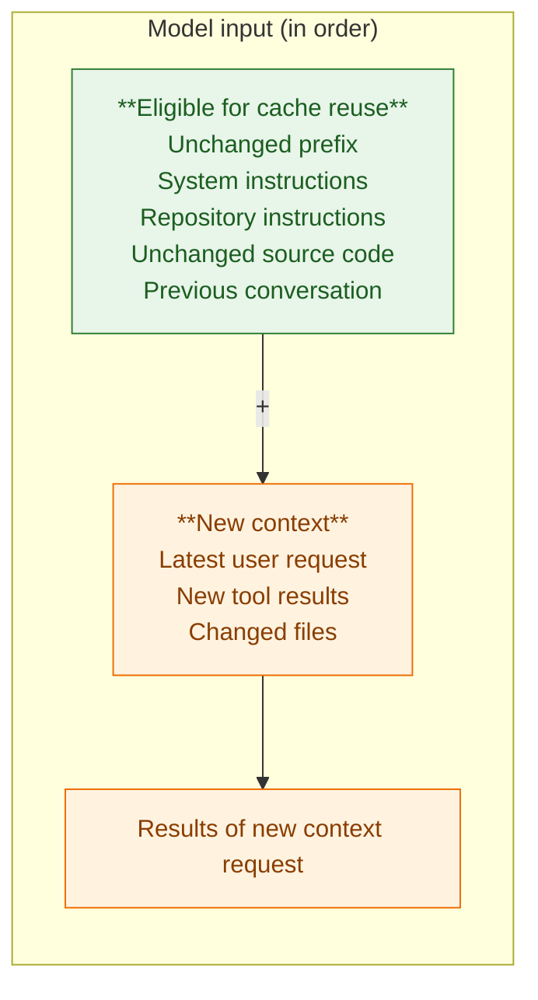
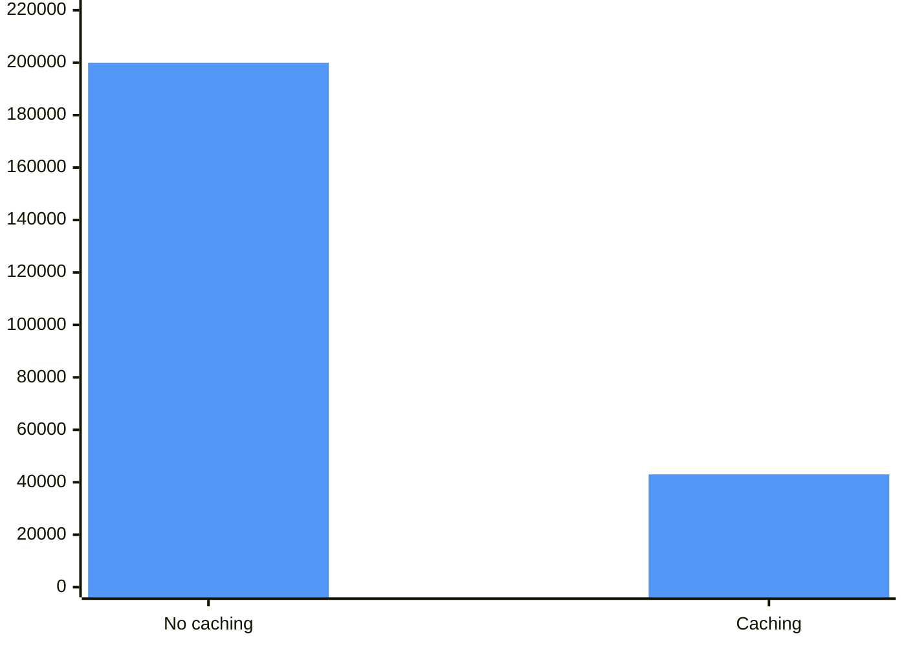

# Best practices for using cached tokens in AI coding assistants

Cached tokens are tokens from previously processed input that an AI model can reuse rather than process again from scratch. This is generally called prompt caching.

Prompt caching is particularly valuable for coding assistants such as GitHub Copilot, OpenAI Codex, and Claude Code, because coding sessions repeatedly reference the same repository instructions, source files, specifications, and conversation history.

The central principle is:

Maximize reuse of stable context while minimizing unnecessary changes to the beginning of the prompt.

Unlike context window compaction, which reduces the amount of context retained, prompt caching aims to reduce the computational cost and latency of processing context that is still needed.

## 1. Common best practices across all three assistants

### 1.1 Understand what caching actually does

Prompt caching typically reuses a previously processed prefix of the model's input.

### Illustrative coding assistant request

**Model processing:** Reuse the eligible cached prefix, then process the new input.



Caching can reduce latency and cost, but it does not increase the model's context window or eliminate the need to manage context carefully.

### 1.2 Keep stable instructions consistent

Repository instructions are frequently reused across coding requests.

Keep files such as `AGENTS.md`, `CLAUDE.md`, and `.github/copilot-instructions.md` stable during a development session.

Avoid repeatedly rewriting instructions, changing their order, or injecting unnecessary dynamic information.

The benefit depends on how the coding assistant constructs prompts and whether those instructions form part of a reusable prefix.

### 1.3 Put stable information before dynamic information

For systems where you control prompt construction, the preferred structure is:

| Position  | Content                                           | Expected reuse |
| --------- | ------------------------------------------------- | -------------- |
| Beginning | System instructions and coding conventions        | High           |
| Next      | Repository architecture and stable specifications | High           |
| Next      | Existing conversation and relevant source code    | Variable       |
| End       | Latest request and changing tool results          | Low            |

This structure preserves a stable prefix, increasing the opportunity for cache hits.

However, managed coding assistants often control prompt ordering internally. You should not assume that rearranging repository documentation will directly change the underlying API prompt order.

### 1.4 Avoid unnecessary changes to reusable context

Prompt caching is sensitive to changes in the cached portion of the input.

For example, avoid inserting timestamps, random identifiers, changing status messages, or repeatedly rewritten summaries into stable instructions.

A change near the beginning of a prompt may reduce reuse of the material that follows it.

### 1.5 Reuse sessions when continuing the same task

Continuing an existing coding session can preserve an unchanged conversation prefix, improving caching opportunities.

Start a new session when switching to unrelated work or when accumulated context becomes counterproductive.

The trade-off is important: a longer session may increase cached-token reuse while also increasing total input tokens and context-window pressure.

### 1.6 Balance caching with context management

Caching and compaction serve different purposes.

| Mechanism                    | Primary benefit                                                |
| ---------------------------- | -------------------------------------------------------------- |
| Prompt caching               | Reduces repeated input-processing cost and potentially latency |
| Context compaction           | Reduces conversation context size                              |
| Subagents                    | Isolate context and support delegation                         |
| Persistent instruction files | Preserve reusable project guidance                             |
| Fresh sessions               | Eliminate irrelevant conversation history                      |

Do not retain large amounts of irrelevant conversation history merely to improve cache-hit rates.

### 1.7 Avoid unnecessary cache fragmentation

Frequent changes to model selection, tool configuration, system instructions, or prompt structure may reduce cache reuse.

When using multiple models, remember that cache reuse is generally tied to compatible model and provider infrastructure. Do not assume that switching models preserves the same cache.

### 1.8 Measure actual benefit

Where usage metrics are available, evaluate:

- Cached input tokens
- Uncached input tokens
- Cache-hit percentage
- Request latency
- Total cost per completed task

A useful metric is:

$$
\text{Cache hit rate} = \frac{\text{Cached input tokens}}{\text{Total input tokens}}\times100\\% 
$$

A high cache-hit rate is not necessarily optimal if the agent is repeatedly processing excessive context.

## 2. GitHub Copilot-specific practices

GitHub Copilot manages prompt caching internally, so developers generally optimize caching indirectly through model selection, session management, and stable context.

### 2.1 Avoid unnecessary model switching

GitHub explicitly identifies switching models mid-session as a cache-invalidating operation.

A different model cannot reuse the previous model's cache.

Recommendation: Select a suitable model at the beginning of a task and retain it unless a change is justified by task complexity or quality.

Copilot's automatic model selection is another option, but automatic routing should not be interpreted as a guarantee that every request uses the same cache.

### 2.2 Account for cache expiration

GitHub documents cache expiration after inactivity, citing 24 hours for OpenAI models and approximately one hour for most others in its optimization guidance.

When returning to an older session, a large conversation may need to be processed again without cached-token discounts.

Consider starting a new session or compacting the old one when its history is no longer necessary.

### 2.3 Use compaction strategically

In Copilot CLI, `/compact` can reduce the amount of context that must be processed after a cache expires.

However, compaction changes the prompt prefix and can reduce cache reuse immediately afterward.

Therefore, compact when reducing context is more valuable than preserving the existing cache.

### 2.4 Understand cached-token billing

GitHub's AI credit billing distinguishes ordinary input, cached input, cache writes where applicable, and output tokens.

Its model pricing tables show that cached input is generally less expensive than uncached input, but cache writes may have their own charges.

Copilot recommendation: Keep a consistent model throughout related work, avoid unnecessary session interruptions, and use compaction to manage large or expired contexts rather than trying to maximize caching at all costs.

## 3. OpenAI Codex-specific practices

Codex CLI has particularly relevant architectural guidance because OpenAI has published how its agent loop preserves prompt-cache efficiency.

### 3.1 Take advantage of Codex's stable prompt structure

OpenAI describes several Codex CLI design choices intended to preserve caching:

- Keep system instructions stable.
- Keep tool definitions consistently ordered.
- Preserve sandbox and environment configuration.
- Append new messages rather than rewriting earlier conversation content.

These choices preserve the longest possible reusable prompt prefix.

Most of this behavior is managed by Codex itself. Developers should avoid introducing unnecessary changes to repository instructions and runtime configuration.

### 3.2 Keep AGENTS.md stable

Because `AGENTS.md` supplies repository guidance, repeatedly modifying it during a session can change the prompt material that Codex processes.

Use it for durable instructions, not temporary status information.

For example, keep the project's coding standards in `AGENTS.md` but place changing implementation progress in a separate task file.

### 3.3 Avoid unnecessary configuration changes

Codex's prompt construction includes tool definitions, sandbox configuration, and environment information.

OpenAI describes appending configuration changes to the conversation instead of rewriting the original prefix.

For ordinary CLI use, keep model and environment settings consistent unless the task requires a change.

### 3.4 Understand compaction's effect on caching

Codex's `/compact` command reduces accumulated context but also changes the reusable conversation prefix.

Use it when context pressure becomes significant, after a development milestone, or when resuming work after a long interruption.

Do not compact solely because a session has accumulated cached tokens.

### 3.5 Distinguish Codex CLI from API-level controls

If you are building your own Codex-based agent harness using the OpenAI API, additional controls become available.

These include prompt-cache configuration, cache accounting, and explicit cache breakpoints on supported models.

OpenAI's documentation also describes preserving conversation history and appending configuration changes to maintain prefix reuse.

For newer models, account for both cache-write costs and discounted cache reads rather than assuming all cache activity is free.

Codex recommendation: Preserve stable repository instructions, let Codex manage its prompt structure, avoid unnecessary runtime changes, and use compaction when context reduction outweighs cache reuse.

## 4. Claude Code-specific practices

Claude Code uses Anthropic's prompt caching infrastructure. It also exposes some caching-related behavior through its configuration and usage reporting.

### 4.1 Understand cache creation versus cache reads

Anthropic distinguishes between creating a cached prefix and reusing it.

Its standard API pricing structure includes:

| Operation            | Relative cost |
| -------------------- | ------------- |
| Uncached input       | 1.00×         |
| 5-minute cache write | 1.25×         |
| 1-hour cache write   | 2.00×         |
| Cache read           | 0.10×         |

These multipliers describe Anthropic's documented API caching model; your effective Claude Code subscription or provider billing may differ.

The implication is that caching becomes especially attractive when the same prefix is reused repeatedly.

### 4.2 Choose cache duration based on usage patterns

Anthropic supports 5-minute and 1-hour prompt-cache durations.

For API-key users, Claude Code documents an environment variable for requesting the longer duration:

```
export ENABLE_PROMPT_CACHING_1H=1
```

This can be useful for workflows with longer gaps between interactions, but the higher cache-write cost must be considered. Claude Code subscription users may have different default behavior.

Do not enable a longer cache duration automatically. Evaluate whether enough reuse occurs to justify the additional write cost.

### 4.3 Keep CLAUDE.md stable

`CLAUDE.md` is loaded as part of Claude Code's project context.

Keep stable instructions in this file and changing task information elsewhere.

For example, repository architecture and coding conventions belong in `CLAUDE.md`, while temporary debugging notes belong in a separate task file.

### 4.4 Limit unnecessary tools and integrations

Claude Code can load context from skills, MCP servers, and other extensions.

Keep enabled integrations relevant to the work. Large or changing tool definitions can increase context overhead and may affect reusable prompt prefixes.

Claude Code's documentation describes how different extensions contribute to context consumption.

### 4.5 Monitor token usage

Claude Code provides usage-related commands such as:

```
/cost
/context
```

Use `/cost` to inspect reported usage and cost information, and `/context` to inspect context consumption.

The detail available depends on whether Claude Code is operating through a subscription, API key, or another provider.

Claude Code recommendation: Keep project instructions stable, avoid unnecessary model switching, use cache-duration settings only when economically justified, and monitor cache reuse where usage data is available.

## 5. Comparison across coding assistants

| Capability                               | GitHub Copilot                  | Codex CLI                   | Claude Code                      |
| ---------------------------------------- | ------------------------------- | --------------------------- | -------------------------------- |
| Automatic prompt caching                 | Yes                             | Yes                         | Yes                              |
| Cached input discounts                   | Model-dependent                 | Model-dependent             | Yes                              |
| Cache-write charges                      | Model-dependent                 | Model-dependent             | Yes                              |
| Direct cache control in normal CLI usage | Limited                         | Limited                     | Some configuration               |
| Cache duration configuration             | Managed by provider             | Managed by runtime/provider | Configurable in supported setups |
| Impact of model switching                | Can invalidate reuse            | Can invalidate reuse        | Can invalidate reuse             |
| Benefit from stable instruction files    | Yes                             | Yes                         | Yes                              |
| Impact of compaction                     | Changes cached prefix           | Changes cached prefix       | Changes cached prefix            |
| API-level cache controls                 | Depends on provider integration | OpenAI API                  | Anthropic API                    |

## 6. Illustrative caching economics

Consider a coding assistant repeatedly processing 20,000 tokens of stable context across 10 requests.

**Illustrative input-processing cost, in uncached-token equivalents**

| Without caching | With caching |
|---|---|
| **200,000** | **43,000** |



*Assumes first request is a 5-minute cache write at 1.25× and nine
requests are cache reads at 0.10×. Excludes dynamic context and output.*

Under these assumptions, caching reduces input-processing cost for the
stable context by approximately **78.5%**. Actual savings depend on reuse,
cache expiration, provider pricing, and other tokens processed.


This example illustrates why long-running agentic coding sessions can benefit substantially from prompt caching.

## 7. Reusable cached-token optimization policy

## Prompt caching optimization policy

Optimize prompt-cache reuse without compromising task correctness, context quality, or development efficiency.

**Stable context**

- Keep repository instructions and reusable guidance consistent.
- Avoid unnecessary changes to instruction files during active tasks.
- Separate stable project knowledge from frequently changing task information.
- Avoid timestamps and dynamic identifiers in reusable prompt prefixes where prompt construction is controllable.

**Session management**

- Continue existing sessions for related work when appropriate.
- Avoid unnecessary model switching.
- Compact context when accumulated history becomes excessive.
- Do not retain irrelevant history solely to preserve cached tokens.

**Tools and subagents**

- Keep tool configurations stable when practical.
- Avoid loading unnecessary tools or documentation.
- Use subagents for independent, context-intensive investigations.
- Do not assume separate agents share prompt caches.

**Cost optimization**

- Measure cached reads, cache writes, uncached input, and output tokens where available.
- Consider cache expiration and cache-write costs.
- Optimize total cost per successfully completed task rather than cache-hit percentage alone.
- Preserve correctness and validation requirements even when they reduce cache efficiency.

## 8. Recommended approach

Across all three assistants, I would prioritize three practices: stable instructions, consistent model selection, and deliberate session management.

For GitHub Copilot, concentrate on avoiding unnecessary model changes and understanding AI credit charges. For Codex, take advantage of its cache-aware prompt construction and keep `AGENTS.md` stable. For Claude Code, use its caching configuration and cost reporting where available.

One important caution: do not optimize cached-token usage at the expense of context quality. A smaller, relevant prompt that must be processed again may be more efficient than repeatedly reusing a large amount of irrelevant cached context.

### References

- [GitHub: Optimize AI usage and preserve the cache](https://docs.github.com/en/copilot/tutorials/optimize-ai-usage?utm_source=chatgpt.com)
- [GitHub: Models and cached-token pricing](https://docs.github.com/en/copilot/reference/copilot-billing/models-and-pricing?utm_source=chatgpt.com)
- [OpenAI: Prompt Caching 201, including Codex architecture](https://developers.openai.com/cookbook/examples/prompt_caching_201?utm_source=chatgpt.com)
- [OpenAI: Prompt caching guide](https://developers.openai.com/api/docs/guides/prompt-caching?utm_source=chatgpt.com)
- [Anthropic: Prompt caching](https://docs.anthropic.com/en/docs/build-with-claude/prompt-caching?utm_source=chatgpt.com)
- [Claude Code: Token usage and cost management](https://code.claude.com/docs/en/costs?utm_source=chatgpt.com)
