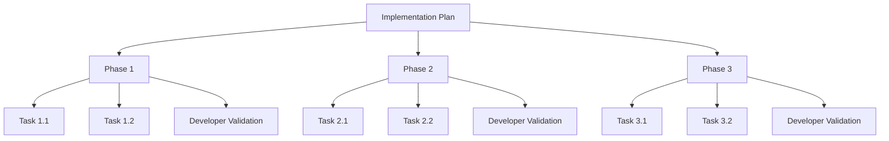
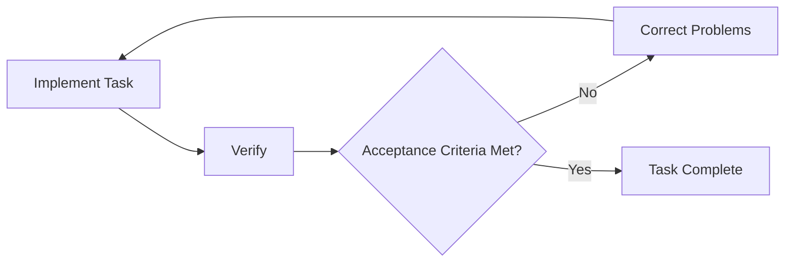
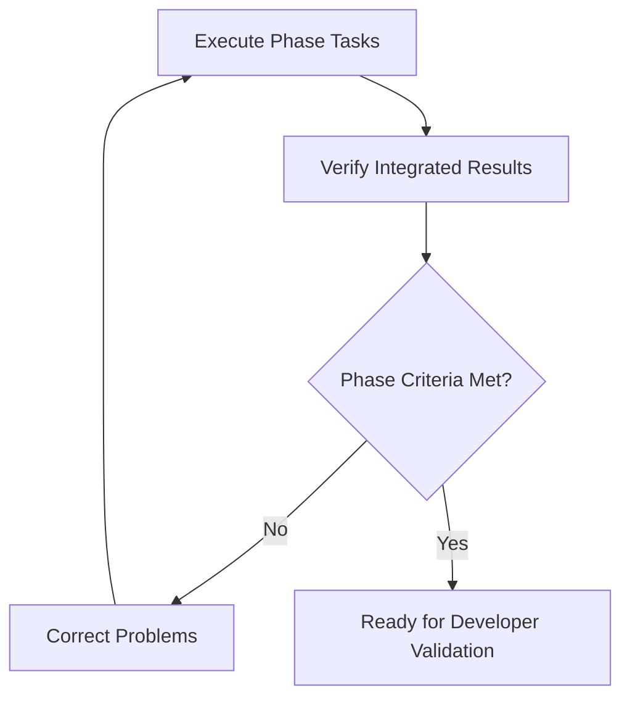
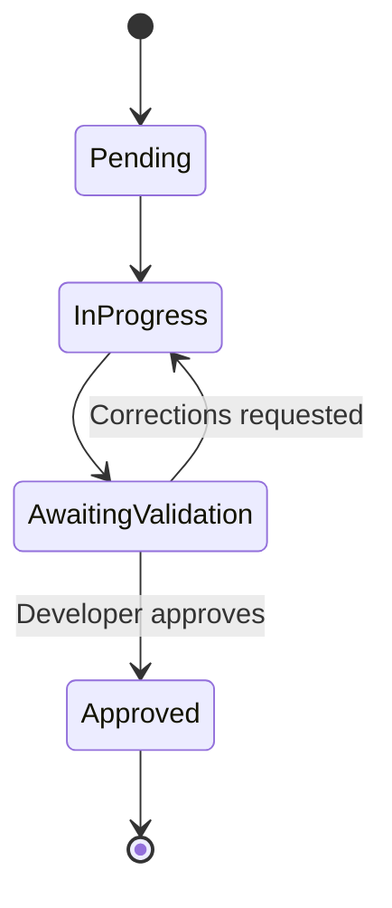
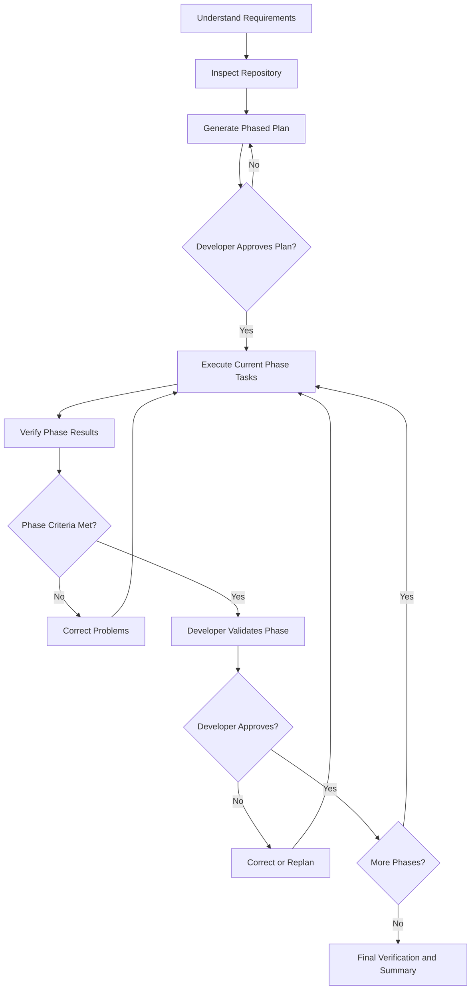

# Good Practices for Planning with AI Coding Assistants

Planning is an important practice when using AI coding assistants such as GitHub Copilot, OpenAI Codex, and Claude Code. A well-structured plan helps the assistant understand the intended outcome, identify dependencies, manage implementation complexity, and verify that changes satisfy requirements.

The central principle is **plan before implementing, organize work into phases, execute using feedback loops, and require developer validation before advancing to the next phase.**

## 1. Good Practices Common to All AI Coding Assistants

### 1.1 Use Planning Selectively

Not every development task requires a formal plan. The level of planning should be proportional to the complexity, uncertainty, and risk of the change.

| Task Complexity | Recommended Approach |
|---|---|
| Trivial | Implement directly without a formal plan |
| Small | Brief plan with a few steps |
| Medium | Structured plan with implementation and verification steps |
| Large | Phased plan with milestones and developer validation gates |
| High-risk | Detailed plan with design review, risk assessment, and explicit approvals |

**Good practice:** Avoid excessive planning for simple changes, but require structured planning for work involving multiple files, architectural decisions, unfamiliar code, or significant risk.

### 1.2 Understand the Codebase Before Planning

The assistant should inspect the relevant repository before proposing implementation steps.

This includes understanding:

- Repository structure and existing architecture.
- Relevant source files, interfaces, and dependencies.
- Established coding conventions and design patterns.
- Existing tests and validation commands.
- Repository-specific instructions, such as `AGENTS.md`, `CLAUDE.md`, or `.github/copilot-instructions.md`.

**Good practice:** Require the assistant to distinguish verified repository facts from assumptions. Plans should reflect the actual codebase rather than an imagined implementation.

### 1.3 Define the Desired Outcome and Acceptance Criteria

A plan should describe what successful completion looks like, not merely the activities to perform.

For example, instead of:

> Add authentication support.

Specify:

> Add authentication support for API requests using bearer tokens. Preserve existing unauthenticated behavior, handle expired credentials, and provide automated tests covering successful and failed authentication.

A useful plan identifies functional requirements, nonfunctional requirements, constraints, and acceptance criteria.

**Good practice:** Define observable, testable outcomes before generating implementation steps.

### 1.4 Organize Plans into Phases and Tasks

For substantial development work, structure the plan hierarchically:



- **Plan:** Defines the overall objective, technical approach, scope, and acceptance criteria.
- **Phase:** Represents a meaningful, independently reviewable increment of functionality.
- **Task:** Represents a bounded implementation activity with explicit completion criteria.

For example, an authentication feature might be organized into three phases:

| Phase | Tasks | Expected Result |
|---|---|---|
| 1. Foundation | Define interfaces, configuration, and token handling | Authentication components can be tested independently |
| 2. Integration | Integrate authentication with the HTTP client and error handling | Authenticated requests work correctly |
| 3. Validation | Add integration tests, regression tests, and documentation | Feature meets all acceptance criteria |

Each phase should produce a result that a developer can evaluate before authorizing subsequent work.

**Good practice:** Use a Plan → Phase → Task hierarchy for substantial changes, with explicit acceptance criteria and developer validation at each phase boundary.

### 1.5 Break Phases into Small, Independently Verifiable Tasks

Each phase should contain manageable tasks with clear objectives, implementation boundaries, and completion conditions.

Tasks should be small enough for the assistant to implement and verify without losing track of their purpose.

Prefer tasks that can be independently tested, reviewed, and committed. Avoid vague steps such as "Implement the entire authentication system."

**Good practice:** Decompose phases into tasks that produce independently verifiable results.

### 1.6 Identify Dependencies and Execution Order

Plans should identify dependencies both between phases and among tasks within a phase.

Some tasks must execute sequentially, while independent tasks may execute in parallel.

For example, defining an interface may be required before implementing components that depend on it. However, independent unit tests and documentation updates may be performed concurrently.

**Good practice:** Explicitly distinguish sequential dependencies from work that can safely execute in parallel. Do not parallelize tasks that modify overlapping code without coordination.

### 1.7 Support Closed-Loop Execution at Task and Phase Levels

Closed-loop execution uses feedback to evaluate progress and correct problems before continuing.

Two levels of closed-loop execution are useful:

**Task-level closed loop:** The assistant implements a task, runs tests, evaluates results, and iterates until the task meets its completion criteria.

**Phase-level closed loop:** The assistant executes the tasks within a phase, evaluates their integrated results against phase-level acceptance criteria, and iterates until the phase is ready for developer validation.

These approaches are complementary. A phase may contain multiple task-level closed loops followed by an integrated phase-level verification.

#### Task-Level Closed Loop



#### Phase-Level Closed Loop



**Good practice:** Use automated feedback loops at the task or phase level, with explicit exit criteria that determine when the work is ready for developer validation.

### 1.8 Require Developer Validation at Phase Boundaries

After completing a phase and its automated verification, the assistant should pause for developer validation.

The assistant should provide a phase-completion report covering:

- Implemented changes.
- Acceptance criteria satisfied.
- Tests and verification results.
- Known limitations and unresolved issues.
- Deviations from the approved plan.

The developer may approve the phase, request corrections, or revise the remaining plan.

**Good practice:** Treat developer approval as a mandatory phase-exit criterion. Do not advance to the next phase without explicit approval.

### 1.9 Review the Plan Before Execution

For substantial changes, the assistant should present its proposed plan before modifying code.

The developer should review the architecture, phase boundaries, task decomposition, dependencies, risks, and verification strategy.

For high-risk work, an independent coding assistant or model may also critique the plan.

**Good practice:** Separate planning from implementation when review would materially reduce risk. Approve the overall plan before beginning and validate results at each subsequent phase boundary.

### 1.10 Maintain the Plan as a Living Artifact

Implementation frequently reveals new information, such as unexpected dependencies, incorrect assumptions, or architectural constraints.

The assistant should update the plan when these discoveries materially affect the remaining work.

Track the status of phases and tasks, verification results, developer feedback, and approvals.

A useful phase lifecycle is:



If developer validation fails, the phase returns to **In Progress** for corrections and revalidation.

**Good practice:** Maintain an accurate plan reflecting actual progress, decisions, feedback, and remaining work. Replan when necessary rather than following an outdated plan blindly.

### 1.11 Persist Plans for Long-Running Development

For work spanning multiple sessions or context windows, store the plan in the repository or another persistent workspace.

For example:

```text
docs/
  plans/
    authentication.md
```

The plan should record objectives, phases, tasks, decisions, progress, verification results, and developer approvals.

This enables the assistant to resume work after context compaction or a new session without reconstructing the development history.

**Good practice:** Persist substantial plans outside conversation history and keep them synchronized with implementation progress.

### 1.12 Limit Scope and Avoid Speculative Changes

Plans can encourage assistants to introduce improvements beyond the requested work.

For example, adding authentication should not automatically trigger unrelated refactoring of logging, configuration, and networking components.

**Good practice:** Distinguish necessary changes from optional improvements. Defer unrelated work unless required to satisfy the acceptance criteria.

---

## 2. Recommended Phased Planning and Execution Workflow

The following workflow combines planning, closed-loop execution, and developer validation.



The workflow has three distinct responsibilities:

- **Planning:** Establish the overall implementation approach, phases, dependencies, and acceptance criteria.
- **Execution:** Allow the coding assistant to implement and verify work through task-level or phase-level closed loops.
- **Validation:** Require the developer to review and approve each phase before proceeding.

This approach balances assistant autonomy with developer oversight.

---

## 3. Practices Specific to Coding Assistants

The following describes how these principles can be applied to individual tools. Exact features and commands may vary by version and environment.

| Capability | GitHub Copilot | OpenAI Codex | Claude Code |
|---|---|---|---|
| Planning | Plan-oriented chat workflows | Plan mode | Plan mode |
| Repository instructions | `.github/copilot-instructions.md`, `AGENTS.md` | `AGENTS.md` | `CLAUDE.md` |
| Persistent plans | Markdown files | Markdown files | Markdown files |
| Execution | Agent mode | Codex agent execution | Claude Code agent execution |
| Phase validation | Explicit developer review | Explicit developer review | Explicit developer review |
| Progress tracking | Plan file or task tracking | Plan file or task tracking | Plan file or task tracking |

### 3.1 GitHub Copilot

For GitHub Copilot in VS Code, separate planning from code modification.

Use a planning-oriented chat workflow to inspect the repository and generate a phased implementation plan. Review and approve the plan before switching to Agent mode for implementation.

Use `.github/copilot-instructions.md` for repository conventions and persist substantial plans in Markdown files.

At each phase boundary, instruct Copilot to summarize completed work, verification results, and outstanding issues, then stop until the developer approves continuation.

**Recommended practice:** Use planning workflows to establish scope and phases, Agent mode for implementation, and explicit developer validation before advancing.

### 3.2 OpenAI Codex

Codex supports planning-oriented workflows for analyzing requirements and proposing implementation approaches before modifying code.

Use `AGENTS.md` to document repository conventions, test commands, architectural constraints, and persistent instructions.

For substantial changes, request a phased plan with explicit tasks, dependencies, acceptance criteria, and developer validation gates.

Where subagents are available, delegate bounded investigation, implementation, or review tasks while maintaining central coordination of the overall plan.

**Recommended practice:** Require Codex to execute one approved phase at a time, verify its results, update the persistent plan, and await developer approval before proceeding.

### 3.3 Claude Code

Claude Code provides Plan mode for exploring the codebase and preparing implementation approaches before making changes.

Use `CLAUDE.md` for persistent project instructions and store substantial implementation plans in repository Markdown files.

Task management and subagent capabilities can support decomposition, parallel investigation, and progress tracking.

Require Claude Code to complete automated verification and present a phase-completion report before continuing.

**Recommended practice:** Use Plan mode to generate the phased implementation approach, execute tasks with feedback loops, and enforce explicit human validation at phase boundaries.

---

## 4. Recommended Implementation Plan Structure

A consistent plan format makes plans easier to review, execute, and resume.

| Section | Purpose |
|---|---|
| Objective | Define what the implementation must accomplish |
| Current state | Describe relevant existing behavior and architecture |
| Requirements | Capture functional and nonfunctional expectations |
| Constraints | Document compatibility, security, performance, and scope restrictions |
| Assumptions | Identify facts requiring confirmation |
| Approach | Explain the proposed technical solution and rationale |
| Phases | Define independently reviewable increments |
| Tasks | Specify implementation activities within each phase |
| Dependencies | Identify sequencing and parallelization opportunities |
| Verification | Define task-level and phase-level checks |
| Validation gates | Specify developer review and approval requirements |
| Risks | Identify potential problems and mitigations |
| Progress | Track task status, phase status, results, and approvals |

Each phase should include an objective, tasks, dependencies, acceptance criteria, verification strategy, expected deliverables, and developer approval requirement.

For large changes, also document rejected alternatives and significant architectural decisions.

---

## 5. Reusable Planning Prompt

The following prompt can be used with GitHub Copilot, Codex, or Claude Code.

### Planning Instructions

You are acting as a senior software engineer preparing and executing a phased implementation plan.

**Objective:** [Describe the requested feature or change]

Before writing or modifying code:

1. Inspect the relevant repository structure, source code, tests, and project instructions.
2. Identify the current architecture, dependencies, conventions, and constraints.
3. Clarify ambiguous requirements and distinguish verified facts from assumptions.
4. Propose an implementation approach consistent with the existing architecture.
5. Organize the plan into meaningful, independently reviewable phases.
6. Break each phase into small, independently verifiable tasks.
7. Identify dependencies between phases and tasks, including safe parallelization opportunities.
8. For each phase, specify:
   - Objective and expected deliverables.
   - Tasks and dependencies.
   - Acceptance criteria.
   - Verification strategy.
   - Developer validation requirements.
9. Identify technical risks, compatibility concerns, and alternatives where relevant.
10. Avoid unrelated refactoring or speculative enhancements.

Present the complete plan for developer review and approval before implementing changes.

### Execution Instructions

After plan approval:

1. Execute only the current approved phase.
2. Use task-level or phase-level closed-loop execution as appropriate.
3. Implement, verify, evaluate feedback, and correct problems until acceptance criteria are satisfied.
4. Perform phase-level verification, including integration checks where applicable.
5. Update the plan with task status, verification results, and relevant decisions.
6. Produce a phase-completion report containing:
   - Changes implemented.
   - Acceptance criteria satisfied.
   - Tests and verification results.
   - Known limitations or unresolved issues.
   - Deviations from the approved plan.
7. Stop and request explicit developer validation.
8. Do not begin the next phase until the developer approves the current phase.
9. If validation identifies problems, correct them and repeat verification.
10. If significant discoveries invalidate the remaining plan, propose revisions for developer approval.

### Completion Instructions

After all phases are approved:

- Run appropriate final regression and integration checks.
- Summarize the implementation and verification results.
- Identify any outstanding issues or follow-up work.
- Update the persistent plan to reflect final status.

For substantial work, save the plan as a Markdown file so it can be reused across sessions and context windows.

---

## 6. Common Planning Anti-Patterns

| Anti-Pattern | Better Practice |
|---|---|
| Planning without inspecting the codebase | Investigate existing code first |
| Overplanning trivial changes | Scale planning effort to complexity |
| Large, monolithic implementation plans | Organize work into phases and tasks |
| Vague tasks without completion criteria | Define bounded, verifiable tasks |
| Planning implementation without verification | Include verification at task and phase levels |
| Executing an entire plan without checkpoints | Require developer validation at phase boundaries |
| Treating automated tests as sufficient developer approval | Separate automated verification from human validation |
| Blindly following an outdated plan | Replan when new evidence requires it |
| Keeping plans only in chat history | Persist substantial plans |
| Expanding scope during implementation | Enforce explicit scope boundaries |
| Using multiple agents without coordination | Assign clear ownership and integration responsibilities |

---

## 7. Key Recommendations

For an agent-ready software repository, prioritize six practices:

1. **Repository-aware planning:** Inspect existing code, architecture, and instructions before generating a plan.
2. **Hierarchical planning:** Organize substantial work into plans, phases, and independently verifiable tasks.
3. **Plan review:** Require developer approval of the overall approach before implementation.
4. **Closed-loop execution:** Use automated feedback at task and phase levels to detect and correct problems.
5. **Developer validation gates:** Require explicit developer approval before advancing between phases.
6. **Persistent planning artifacts:** Store plans, progress, decisions, and validation results outside the conversation context.

The central distinction is that **a plan is not merely a checklist for the coding assistant to execute**. It defines the implementation approach, the boundaries of assistant autonomy, the verification required to establish technical correctness, and the developer decisions required to authorize further work.

The resulting model is **phased, closed-loop development with human validation gates**: the assistant operates autonomously within a phase, while the developer retains control over progression through the overall implementation plan.