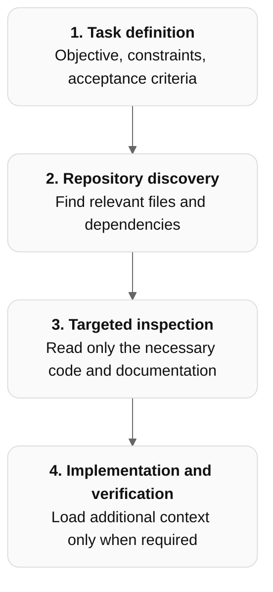

# Best practices for context window management in AI coding assistants

Effective context window management is essential when using GitHub Copilot, OpenAI Codex, and Claude Code, particularly for long-running development sessions, large codebases, and multi-agent workflows.

The objective is not simply to minimize tokens. It is to ensure that the coding assistant has the right information at the right time, while avoiding irrelevant context, stale assumptions, and loss of important decisions.

A useful principle is:

Treat the context window as a limited working memory, not as a permanent record of everything the agent has done.

## 1. Common best practices across all three assistants

### 1.1 Keep context focused on the current task

Avoid supplying the entire repository, extensive documentation, or unrelated conversation history.

Instead, provide the specific requirements, relevant files, architectural constraints, and acceptance criteria.

| Less effective                               | More effective                                                 |
| -------------------------------------------- | -------------------------------------------------------------- |
| Analyze the entire repository                | Examine the authentication module and its dependencies         |
| Read all documentation                       | Read the API specification and relevant architecture decisions |
| Review all previous changes                  | Review the current diff against the target branch              |
| Include complete build logs                  | Include the error summary and relevant stack trace             |
| Continue a lengthy conversation indefinitely | Start a fresh session with a concise task summary              |

The goal is to maximize the proportion of useful information in the context window.

### 1.2 Use progressive context loading

Rather than loading all potentially relevant information at the beginning, retrieve information incrementally.



This approach is sometimes called just-in-time context retrieval.

### 1.3 Keep persistent instructions concise

Use repository-level instruction files to record stable information that applies across development sessions.

| Assistant      | Common instruction file                                        |
| -------------- | -------------------------------------------------------------- |
| GitHub Copilot | `.github/copilot-instructions.md`, `AGENTS.md` where supported |
| Codex          | `AGENTS.md`                                                    |
| Claude Code    | `CLAUDE.md`                                                    |

Include repository structure, coding conventions, architectural constraints, and essential test commands.

Avoid lengthy tutorials, duplicated documentation, or details relevant to only one task. Use references to additional documentation when necessary.

### 1.4 Summarize at meaningful milestones

Long-running tasks accumulate context from tool outputs, debugging attempts, intermediate reasoning, and abandoned approaches.

Periodically create a concise checkpoint containing:

- Original objective and acceptance criteria
- Decisions made and their rationale
- Files modified
- Tests completed and results
- Known issues and unresolved questions
- Next actions

Summarize after completing a significant development phase, before switching tasks, or before a context reset.

Example prompt:

```text
Create a concise checkpoint summary so another coding assistant can continue
this task after a context reset. Include:

- The objective, acceptance criteria, and user constraints.
- Current progress: what is complete and what remains.
- Key decisions and a brief rationale for each.
- Files modified and the purpose of each change.
- Tests and checks run, their results, and any checks still needed.
- Known issues, unresolved questions, and unverified assumptions.
- The next actions, in priority order, with relevant file paths and commands.

Describe the current state rather than recounting the conversation. Clearly
distinguish completed work from proposed work and verified facts from assumptions.
Omit verbose tool output and abandoned approaches unless they explain a current
constraint or prevent repeating a failed attempt. Do not include secrets.
Save the summary as CHECKPOINT.md in the repository root, updating the file if
it already exists. Reply with the path to the saved file.
```

### 1.5 Separate durable knowledge from temporary context

Not all information belongs in the conversation.

| Information             | Recommended location          |
| ----------------------- | ----------------------------- |
| Coding conventions      | Repository instructions       |
| Architectural decisions | Architecture decision records |
| API contracts           | Specifications and schemas    |
| Implementation plan     | Plan document                 |
| Current progress        | Checkpoint or task notes      |
| Source code             | Repository files              |
| Temporary investigation | Agent context                 |

The repository should remain the authoritative source of project knowledge.

### 1.6 Use subagents to isolate context

Subagents can investigate a topic in a separate context and return a concise summary to the primary agent.

For example, instead of having the primary agent read hundreds of test files, delegate test coverage analysis to a subagent and request only the findings, evidence, and recommended actions.

This is particularly effective for parallel codebase exploration, security analysis, and independent review.

However, subagents still consume tokens and may introduce coordination overhead. Context isolation does not necessarily reduce total token usage.

### 1.7 Manage tool output

Tool outputs can consume substantial context, particularly test logs, compiler errors, search results, and generated files.

Prefer targeted searches, limited file ranges, summarized test failures, and concise command output.

Preserve complete logs as files when needed, rather than repeatedly inserting them into the conversation.

### 1.8 Reset context at task boundaries

A fresh session is often preferable when moving to a substantially different task.

Before resetting, preserve relevant decisions and progress in repository files or a concise handoff summary. See [section 1.4: Summarize at meaningful milestones](#14-summarize-at-meaningful-milestones) for a checkpoint prompt.

Do not rely on the next session automatically recovering all details from the previous conversation.

## 2. GitHub Copilot-specific practices

These recommendations focus on Copilot in VS Code.

### 2.1 Monitor context window utilization

VS Code provides a context window indicator in the Chat input. Hovering over it displays token usage and a breakdown of context consumption.

Use this to identify when conversation history and tool outputs are becoming substantial. Available context capacity depends on the selected model.

### 2.2 Use `/compact` proactively

VS Code supports manual and automatic conversation compaction.

```
/compact Retain the implementation decisions,
API contracts, modified files, failing tests,
and remaining work.
```

Automatic compaction occurs as the context fills, but manually compacting after major milestones gives you more control over what the summary emphasizes.

Compaction can omit details, so important decisions should also be recorded in files.

### 2.3 Use focused instruction files

Keep `.github/copilot-instructions.md` concise and link to supporting documents such as `ARCHITECTURE.md` and `CONTRIBUTING.md`.

This is preferable to copying extensive documentation into global instructions, because project-wide instructions are repeatedly included in agent context.

### 2.4 Exclude irrelevant files from search

VS Code supports `.gitignore`, `search.exclude`, and `files.exclude` to reduce noisy search results.

For example, exclude generated artifacts, build directories, and large logs when they are not needed. Even search snippets consume context tokens.

### 2.5 Use separate chats and forks

Use `/fork` when investigating alternative solutions that share existing context. Start a new chat when you need fresh context, and a new session for an unrelated task or workspace.

Copilot also supports separate chats within supported sessions, so test investigations and implementation work can have independent conversation histories.

Copilot recommendation: Monitor context usage, compact at milestones, keep instructions short, and use separate chats or subagents to prevent unrelated investigations from polluting the main conversation.

## 3. OpenAI Codex-specific practices

These recommendations focus on Codex CLI.

### 3.1 Use `/status` and `/compact`

Codex provides session management commands for inspecting context usage and reducing accumulated conversation history.

```
/status
```

Use this to inspect session information, including context utilization where supported.

```
/compact
```

Use compaction when continuing the same task after substantial exploration or debugging. Do not assume every intermediate detail will survive compaction.

### 3.2 Keep AGENTS.md short and hierarchical

Codex discovers `AGENTS.md` instructions along the directory hierarchy.

A recommended structure is:

```
repository/
├── AGENTS.md
├── src/
│   └── AGENTS.md
├── tests/
│   └── AGENTS.md
└── docs/
    └── architecture.md
```

Use the root file for universal rules and nested files for module-specific guidance.

Avoid duplicating instructions across levels. Codex can load multiple applicable instruction files, and those instructions consume context.

### 3.3 Maintain phase-specific context files

For longer development tasks, preserve implementation decisions and progress in dedicated files.

For example:

```
harness/
└── context/
    ├── phase-01-design.md
    ├── phase-02-implementation.md
    └── phase-03-validation.md
```

Each file should contain only information that matters to later phases. OpenAI's Codex workflow guidance describes this pattern for maintaining durable context across development phases.

### 3.4 Review skills and instructions for unnecessary content

Codex supports reusable skills, but large skill descriptions and excessive instructions can increase context overhead.

Keep skill descriptions concise, move detailed procedures into supporting files, and load specialized guidance only when needed.

OpenAI specifically recommends revisiting older, overly prescriptive instructions as coding models become more capable.

### 3.5 Distinguish CLI compaction from API compaction

OpenAI's Responses API supports automatic compaction thresholds and explicit compaction calls.

These are API capabilities, not necessarily user-configurable Codex CLI settings. Avoid assuming that an API setting such as `compact_threshold` is available directly in Codex CLI.

Codex recommendation: Combine concise hierarchical `AGENTS.md` instructions with phase-specific context files. Use `/status` to monitor context and `/compact` when a task remains active but its conversation has accumulated excessive history.

## 4. Claude Code-specific practices

### 4.1 Use `/context` to inspect consumption

Claude Code provides a `/context` command to inspect context window usage.

```
/context
```

Use it to understand how much context is being consumed and to identify unnecessary overhead.

### 4.2 Use `/compact` with preservation instructions

Claude Code supports explicit compaction.

```
/compact Preserve the API design, decisions,
modified files, test failures, and remaining work.
```

Claude Code also supports automatic compaction when approaching its context limit.

The recommended practice is to compact after a coherent phase rather than repeatedly compacting during active investigation.

### 4.3 Use `/clear` for unrelated tasks

Use `/clear` when starting a genuinely different task that does not require the previous conversation.

Before clearing, write any important decisions, progress, and remaining work into durable files.

For related tasks, compaction is generally preferable because it preserves useful continuity.

### 4.4 Organize CLAUDE.md hierarchically

Keep `CLAUDE.md` focused on essential repository instructions.

Use modular instructions and supporting documentation for specialized knowledge. Avoid turning `CLAUDE.md` into a comprehensive repository manual.

The same principle applies to Claude Code skills: provide enough information to identify when a skill is useful without eagerly loading all of its detailed instructions.

### 4.5 Use subagents for context isolation

Claude Code subagents have separate context windows.

Delegate tasks that would otherwise introduce extensive search results, logs, or exploratory reasoning into the main conversation.

Ask each subagent to return a compact report containing findings, evidence, and unresolved issues.

### 4.6 Preserve state for multi-window workflows

Anthropic recommends saving progress to files for work that spans multiple context windows.

This can include task lists, test results, setup scripts, and progress notes. A new context window can then reconstruct the relevant state from the filesystem instead of relying exclusively on summarized conversation history.

Claude Code recommendation: Use `/context` to inspect usage, `/compact` for ongoing work, `/clear` at task boundaries, and persistent progress files for long-running tasks.

## 5. Comparison of context management capabilities

| Capability                  | GitHub Copilot (VS Code) | Codex CLI         | Claude Code           |
| --------------------------- | ------------------------ | ----------------- | --------------------- |
| Inspect context usage       | Context indicator        | `/status`         | `/context`            |
| Manual compaction           | `/compact`               | `/compact`        | `/compact`            |
| Automatic compaction        | Yes                      | Supported         | Yes                   |
| Fresh conversation          | New chat/session         | New session       | `/clear`              |
| Persistent instructions     | Copilot instructions     | `AGENTS.md`       | `CLAUDE.md`           |
| Context-isolated subagents  | Yes                      | Yes, when enabled | Yes                   |
| Durable progress files      | User-managed             | User-managed      | User-managed          |
| Parallel isolated workflows | Sessions/worktrees       | Agents/worktrees  | Subagents/agent teams |

These capabilities depend on the product version and interface. In particular, VS Code's Copilot harness and the Codex or Claude harnesses running inside VS Code may expose different controls.

## 6. A reusable context management policy

The following prompt can be adapted for all three coding assistants and incorporated into repository instructions.

## Context window management policy

Manage context deliberately to maintain accuracy, efficiency, and continuity across development sessions.

**Context acquisition**

- Load only information relevant to the current task.
- Discover files and dependencies progressively.
- Prefer targeted searches over reading entire directories.
- Avoid unnecessary tool output, duplicate documentation, and extensive logs.

**Persistent knowledge**

- Keep repository instructions concise.
- Store architecture, requirements, and design decisions in version-controlled files.
- Maintain a short progress file for long-running tasks.
- Treat repository artifacts as the authoritative source of implementation state.

**Compaction and session management**

- Monitor context utilization using available assistant tools.
- Compact at meaningful milestones when continuing the same task.
- Before compaction, preserve objectives, decisions, modified files, test results, and remaining work.
- Start fresh sessions for unrelated tasks.
- Revalidate important assumptions after compaction or a context reset.

**Subagents**

- Delegate context-intensive, independent investigations to subagents.
- Keep exploratory tool output within the subagent's context.
- Require concise, evidence-based summaries.
- Avoid returning large amounts of raw data to the primary agent.

**Long-running tasks**

- Divide development into coherent phases.
- Record progress and outstanding work at phase boundaries.
- Resume from saved project state rather than relying exclusively on conversation history.
- Verify changes and run relevant tests after context transitions.

## 7. Recommended operating approach

I recommend using the same basic workflow across all three assistants.

| Development stage | Context management practice                                           |
| ----------------- | --------------------------------------------------------------------- |
| Start             | Fresh context, concise requirements, relevant repository instructions |
| Explore           | Progressive file discovery; delegate broad investigation              |
| Plan              | Record decisions and acceptance criteria                              |
| Implement         | Keep context focused on the current module                            |
| Validate          | Use concise test output and independent review                        |
| Checkpoint        | Save progress, decisions, and unresolved issues                       |
| Continue          | Compact if staying on the same task                                   |
| Switch tasks      | Start a fresh context                                                 |

The most important distinction is between compaction and persistent memory. Compaction helps an agent continue a conversation with fewer tokens, but it can lose detail. Durable project files preserve important information independently of the model's context window.

For substantial coding projects, I would prioritize three practices: progressive context loading, persistent phase checkpoints, and context-isolated subagents. Together, these reduce context pollution while making long-running development more reliable.

### References

- [VS Code: Understand context in AI agents](https://code.visualstudio.com/docs/agents/concepts/context?utm_source=chatgpt.com)
- [VS Code: Manage agent sessions and compaction](https://code.visualstudio.com/docs/agents/run/sessions/manage-sessions?utm_source=chatgpt.com)
- [OpenAI: Iterating development workflows with Codex](https://developers.openai.com/cookbook/examples/codex/iterating-development-workflows-with-codex?utm_source=chatgpt.com)
- [OpenAI: Rethinking skills and prompts](https://developers.openai.com/blog/rethinking-skills-and-prompts-for-gpt-6-astra?utm_source=chatgpt.com)
- [Claude Code: Cost and token management](https://code.claude.com/docs/en/costs?utm_source=chatgpt.com)
- [Claude Code: Manage memory and instructions](https://code.claude.com/docs/en/memory?utm_source=chatgpt.com)
