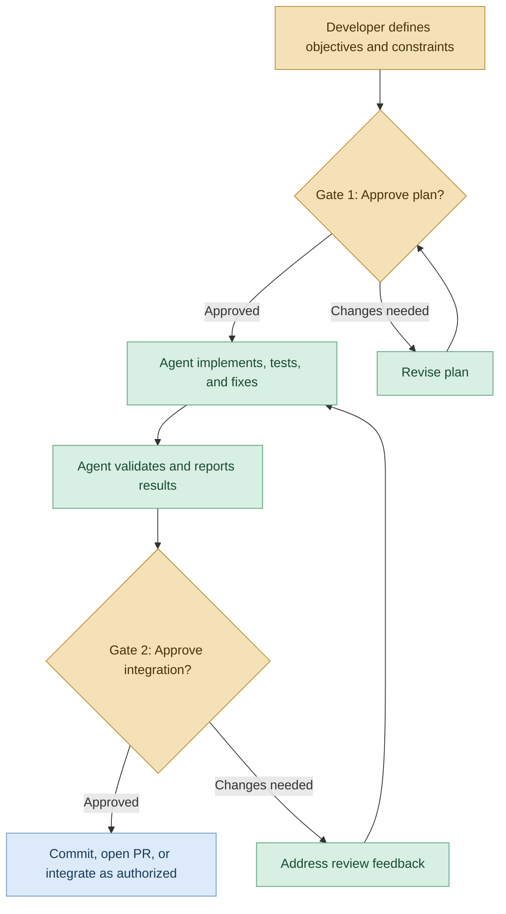
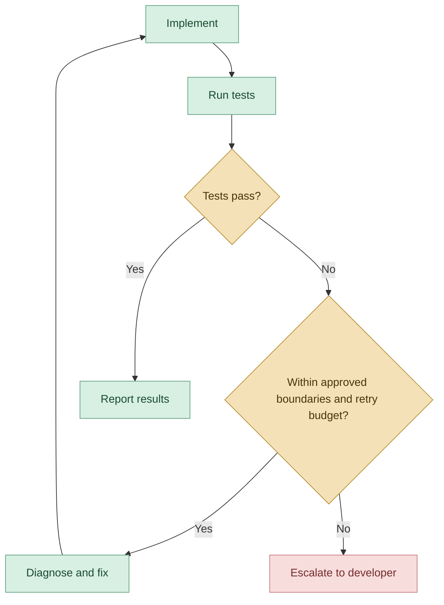

# Good Practices for Long-Running AI Coding Agent Sessions

## Bottom Line

The goal is to **minimize routine permission requests while preserving developer control over consequential decisions**.

For long-running coding sessions using GitHub Copilot, Codex, or Claude Code, use a **risk-based permission model combined with phase-based development gates**.

**Central principle: Approve the boundaries of autonomy, not every action taken within those boundaries.**

An agent should be able to explore, implement, test, debug, and refine a solution without repeatedly interrupting the developer. However, it should require explicit approval before changing the agreed direction, crossing a security boundary, or committing to a significant development milestone.

Distinguish two types of approval:

- **Operational permissions:** May the agent execute a command, modify a file, or invoke a tool?
- **Development approvals:** Is the proposed design, implementation, or result acceptable?

These should be managed independently.

---

## 1. Use a Risk-Based Permission Model

Classify agent actions into three categories.

| Permission Level | Examples | Developer Involvement |
|---|---|---|
| Autonomous | Read files, search code, edit approved files, run tests, lint, format, inspect Git status | None |
| Conditional | Install dependencies, change configurations, modify APIs, expand scope | Approval when outside previously agreed boundaries |
| Explicit approval | Delete important data, access production, expose secrets, publish releases, merge PRs | Always require approval |

**Good Practice:** A failed test should not require developer approval to fix, provided the agent remains within the approved scope.

For example, an agent implementing a feature should be free to:

1. Modify the relevant code.
2. Execute tests.
3. Diagnose failures.
4. Correct its implementation.
5. Repeat until the acceptance criteria pass.

This is a closed-loop development process. The agent should not need separate permission for each iteration.

---

## 2. Establish Approval Gates at Development Milestones

Rather than approving individual commands, approve meaningful transitions between development phases.



### Recommended Approval Gates

| Gate | Developer Approves | Agent May Do Afterward |
|---|---|---|
| 1. Plan approval | Scope, design, acceptance criteria, constraints | Implement independently |
| 2. Integration approval | Test results, changes, remaining risks | Commit, open PR, or integrate as authorized |

For more complex projects, introduce an intermediate gate for architectural changes or completed subsystems.

**Good Practice:** Avoid creating approval gates merely because a certain number of commands, tool calls, or minutes have elapsed. Gates should represent meaningful decisions.

---

## 3. Define the Agent's Autonomy Contract Before Execution

Establish an explicit **autonomy contract** describing what the agent may do without asking permission.

| Dimension | Example Policy |
|---|---|
| Scope | Only modify files related to the approved feature |
| Commands | Run builds, tests, linters, and local diagnostics |
| Dependencies | Use existing dependencies; ask before adding new ones |
| Git operations | Create local commits; do not push or merge without approval |
| Architecture | Follow approved design; ask before material deviations |
| Recovery | Diagnose and retry failures independently |
| Resources | Stay within specified time, cost, and compute limits |
| Reporting | Report results at milestones, not after every action |

Distinguish **preapproved actions** from **unexpected actions**.

For example, approving an implementation plan that explicitly includes adding a particular dependency can also authorize that dependency installation, subject to security policy.

This prevents the developer from approving the same decision twice.

---

## 4. Use Bounded Closed-Loop Execution

Long-running sessions benefit from allowing the agent to iterate independently, but autonomy should have limits.



### Recommended Guardrails

- **Retry limit:** Escalate after repeated unsuccessful attempts, such as three materially different approaches.
- **Scope limit:** Stop if solving the problem requires changes outside the approved scope.
- **Risk limit:** Stop before destructive, security-sensitive, or externally visible actions.
- **Resource limit:** Stop when an agreed time, token, or compute budget is reached.
- **Progress limit:** Escalate when the agent is no longer making measurable progress.

**Good Practice:** Allow the agent to recover from routine failures without asking permission, but prevent indefinite execution when its approach is failing.

---

## 5. Make Approval Gates Durable

Long-running sessions can lose context through compaction, restarts, or handoffs between agents.

Approvals should not exist only in conversation history.

Maintain a lightweight checkpoint file such as `CHECKPOINT.md` containing:

- Current objective and approved scope.
- Approved implementation plan.
- Decisions already made by the developer.
- Work completed and verification results.
- Remaining tasks and known problems.
- Next required approval gate.

This file is particularly valuable when several coding agents work in parallel.

**Good Practice:** Context compaction or session restart should not automatically trigger a new approval request. The agent should first recover the approved boundaries and resume within them.

A checkpoint is a record of approval, not a substitute for the coding tool's actual security permissions.

---

## 6. Configure Coding Assistants to Minimize Operational Interruptions

The specific implementation varies by assistant.

| Coding Assistant | Recommended Approach |
|---|---|
| OpenAI Codex | Use workspace-scoped write permissions and a selective approval policy. Keep sandbox protections enabled. |
| Claude Code | Use project-scoped permission rules to preapprove safe commands and explicitly restrict risky operations. |
| GitHub Copilot | Use supported tool approval settings, workspace trust, and agent instructions to reduce routine prompts while retaining required approvals. |

### Codex CLI Example

A useful starting point for `.codex/config.toml`:

```toml
approval_policy = "on-request"
sandbox_mode = "workspace-write"
```

This permits the agent to work within its sandbox while requesting approval when it needs an action that crosses the sandbox boundary.

It does not mean every command will be automatically approved. Precise behavior depends on the Codex version and execution environment.

**Good Practice:** Prefer constrained autonomy over disabling all approval checks.

Isolate the agent in a dedicated Git worktree, devcontainer, or disposable environment when practical. This reduces the risk associated with granting broad permissions within that environment.

---

## 7. Separate Approval from Notification

Not every significant event requires a decision.

| Event | Recommended Behavior |
|---|---|
| Test failure | Agent fixes independently |
| Feature implementation completed | Record milestone and continue if authorized |
| Unexpected design change required | Request developer approval |
| All acceptance tests pass | Notify developer |
| Ready to merge | Request approval |
| Retry budget exhausted | Escalate with diagnosis |

Frequent notifications can be useful without interrupting the agent's execution.

An approval request should include:

- The decision required.
- Available alternatives.
- The agent's recommendation.
- Consequences of proceeding.

**Good Practice:** Reserve blocking approval requests for decisions that require developer judgment.

---

## 8. Provide an Explicit Operating Instruction

The following instruction can be adapted for Codex, Claude Code, or GitHub Copilot.

### Long-Running Agent Execution Policy

Operate autonomously within the scope of the developer-approved plan.

#### Autonomous Activities

You may perform the following without requesting additional development approval:

- Inspect repository files and documentation.
- Modify code within the approved scope.
- Run builds, tests, linters, and formatting tools.
- Diagnose and correct implementation failures.
- Refactor code as necessary to meet acceptance criteria.
- Repeat implementation and validation until successful.
- Maintain progress checkpoints and report milestones.

All actions remain subject to the coding assistant's configured security permissions.

#### Required Approval Gates

Request explicit developer approval:

1. Before implementing a new plan that has not been approved.
2. Before materially changing the approved architecture or scope.
3. Before introducing unapproved dependencies or security-sensitive changes.
4. Before performing destructive or externally visible operations that have not been explicitly authorized.
5. Before merging, deploying, or publishing changes.

#### Escalation Rules

Stop and request guidance when:

- Repeated attempts fail to produce measurable progress.
- Requirements are ambiguous and materially affect the implementation.
- Work requires crossing an approved scope or security boundary.
- Resource limits are reached.
- Acceptance criteria cannot be satisfied.

#### Progress Management

- Maintain a durable record of progress and approved decisions.
- Resume from the latest checkpoint after context compaction or session restart.
- Do not request approval again for decisions already approved unless circumstances materially change.
- Report completed work, verification results, and remaining risks at each milestone.

#### Guiding Principle

Minimize developer interruptions while preserving human judgment over architecture, scope, security, and integration decisions.

**Note:** These instructions establish behavioral expectations. They do not override the assistant's sandbox, permission system, or organization-level security policies.

---

## 9. Measure Whether the Approach Is Working

Evaluate the effectiveness of the practice using measurable outcomes.

| Metric | Desired Outcome |
|---|---|
| Permission requests per development task | Decrease |
| Developer approval requests | Concentrated at meaningful gates |
| Autonomous test/fix iterations | Increase |
| Unnecessary repeated approvals | Approach zero |
| Changes outside approved scope | Zero |
| Rework after developer review | Decrease |
| Time spent waiting for developer input | Decrease |

The objective is not simply fewer prompts. It is **fewer low-value interruptions without reducing the quality of developer oversight**.

---

## Recommended Practice: Bounded Autonomy with Risk-Based Approval Gates

Grant coding assistants autonomy to execute approved development work through closed-loop implementation, testing, and correction.

Use:

- **Predefined permissions** to eliminate repetitive operational approvals.
- **Durable checkpoints** to preserve decisions and execution state.
- **Explicit developer approval gates** for changes in scope, architecture, security, and integration.
- **Bounded execution** to prevent uncontrolled retries or resource consumption.
- **Milestone reporting** to maintain visibility without unnecessary interruptions.

This provides four important benefits:

| Benefit | Description |
|---|---|
| Agent independence | Routine execution and problem-solving proceed without constant developer intervention |
| Developer judgment | Humans retain control over consequential decisions |
| Reproducibility | Approved decisions and validation evidence are recorded |
| Safety | Permission boundaries and escalation rules constrain autonomous behavior |

### Key Takeaway

**The developer approves what should be done and whether the result is acceptable. The agent determines how to execute the approved work within defined boundaries.**

This separation enables long-running agent sessions with fewer interruptions while preserving meaningful developer oversight.
