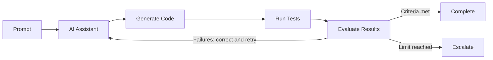

# Good Practices: Open-Loop vs. Closed-Loop Workflows

AI coding assistants such as GitHub Copilot, Codex, and Claude Code can operate in open-loop or closed-loop workflows. The distinction is whether the assistant uses execution feedback to verify and improve its work.

## 1. Understand the Two Workflows

### Open-Loop Workflow

An **open-loop** assistant generates code or recommendations without automatically verifying the results.

**Recommended uses:** Exploration, brainstorming, code explanation, initial code generation, and low-risk changes where immediate verification is unnecessary.

### Closed-Loop Workflow

A **closed-loop** assistant generates code, evaluates the results, and uses feedback to correct problems until completion criteria are met or a stopping condition is reached.

**Recommended uses:** Feature implementation, bug fixes, refactoring, dependency upgrades, and changes requiring correctness verification.

**Good practice:** Use open-loop workflows for exploration and closed-loop workflows for implementation requiring verification. A task may begin open-loop and transition to closed-loop.

## 2. Common Good Practices

These practices apply to GitHub Copilot, Codex, and Claude Code.

### Establish Explicit Completion Criteria

Define what constitutes success before the assistant begins. Specify expected behavior, acceptance criteria, and required verification steps.

**Good practice:** Use measurable success criteria rather than allowing the assistant to determine completion solely from its own assessment.

### Use Automated Feedback

Execute relevant tests, builds, linters, and type checks. Require the assistant to examine failures and correct their underlying causes.

**Good practice:** Prefer executable, independently verifiable feedback over the assistant's subjective assessment of correctness.

### Bound the Feedback Loop

Unrestricted iterations can increase token consumption, execution time, and the risk of introducing unrelated changes.

**Good practice:** Establish correction limits, execution budgets, and escalation conditions. Stop when repeated attempts fail to make meaningful progress.

### Preserve Verification Integrity

Assistants may inadvertently optimize for passing tests rather than satisfying requirements.

**Good practice:** Do not allow the assistant to weaken tests, remove assertions, or modify acceptance criteria merely to declare success.

### Match Verification Effort to Risk

| Change | Recommended Verification |
|---|---|
| Documentation | Formatting and link checks |
| Small code change | Targeted unit tests |
| Feature implementation | Unit and integration tests |
| Cross-component refactoring | Broader regression tests |
| Security-sensitive change | Security checks and human review |

**Good practice:** Apply verification proportional to the scope, complexity, and risk of the change.

### Maintain Human Oversight

Closed-loop execution does not eliminate the need for developer review.

**Good practice:** Require approval for destructive operations, significant architectural decisions, and changes to verification criteria. Keep modifications reviewable through diffs and pull requests.

## 3. Coding Assistant-Specific Practices

| Capability | GitHub Copilot | Codex | Claude Code |
|---|---|---|---|
| Open-loop exploration | Chat and inline suggestions | Explanation and planning workflows | Explanation and planning workflows |
| Closed-loop implementation | Agent mode | Agentic execution | Agentic execution |
| Automated verification | Terminal and test tools | Shell and test tools | Bash and test tools |
| Iteration limits | Prompt instructions | Prompt instructions | Prompt instructions |
| Human oversight | Tool permissions and review | Approval controls | Permission controls |

These are representative capabilities; specific controls vary by product version and environment.

### GitHub Copilot

Use Chat or inline suggestions for open-loop tasks. Use Agent mode when implementation requires tool execution, testing, and iterative correction. Explicitly request verification.

### Codex

Provide acceptance criteria and instruct Codex to run relevant tests after changes. Use approval controls for consequential operations and require reporting of unresolved failures.

### Claude Code

Use planning and explanation workflows for exploration. For implementation, instruct Claude Code to execute tests, inspect failures, and iterate within defined limits. Use permission controls to constrain execution.

## 4. Example Closed-Loop Prompt

> Implement the requested feature using a closed-loop workflow.
>
> After modifying the code, run the relevant tests, linting, and type checks. If verification fails, investigate the cause, correct the implementation, and rerun verification.
>
> Do not weaken existing tests to achieve success. Limit correction attempts to three iterations. Report the final verification results and any unresolved failures.

## 5. Key Recommendation

**Use open loops to explore possibilities and closed loops to establish confidence in results.**

Neither approach is universally better. The objective is to select the appropriate level of feedback, verification, and autonomy for the task.

For agent-ready repositories, the most important enabler of effective closed-loop development is a reliable, executable verification environment with clear success criteria.
