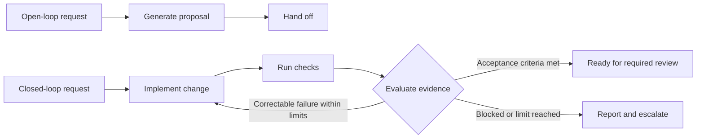

# Defining an Agent-Friendly Repository

Draft presentation outline

**Audience:** Developers, technical leads, and repository maintainers adopting AI coding assistants.

**Suggested length:** 35–40 minutes with the case study, including discussion; 25–30 minutes if the case study is condensed.

**Presentation objective:** Define what makes a repository agent-friendly, connect those qualities to concrete repository artifacts, and give teams a practical way to assess readiness.

**Working definition:** An agent-friendly repository provides discoverable project knowledge, clear instructions and boundaries, executable verification, and persistent task state so a coding assistant can make reviewable changes with appropriate human oversight.

This outline synthesizes the repository's practical guides. The suggested repository layout and case study assessment are proposed applications of those practices, rather than requirements for a particular assistant.

**Running example:** `ide-tester`, a standalone TypeScript VS Code smoke tester, demonstrates these capabilities through its repository structure, instructions, verification tooling, and recorded development workflow. Section 12 includes a concrete mapping and improvement opportunities. Repository inspection baseline: 2026-10-25, commit `efae26b`. This is a structural assessment; build, unit, and GUI checks were not rerun for this presentation. Links to its files use the sibling checkout at `../../ide-tester/`.

## 1. Open-loop and closed-loop workflows

**Key message:** The defining difference is whether execution feedback informs the assistant's next action.

- **Open-loop:** The assistant generates code or recommendations without automatically executing checks and using their results to revise the output.
- **Closed-loop:** The assistant makes a change, runs relevant checks, evaluates the results, and uses that feedback to correct problems until acceptance criteria are met or a stopping condition is reached.

| Dimension | Open-loop | Closed-loop |
| --- | --- | --- |
| Typical flow | Request → generate → hand off | Request → change → check → evaluate → correct or finish |
| Useful for | Brainstorming, explanation, exploring approaches, initial drafts | Features, bug fixes, refactoring, and other changes requiring verification |
| Evidence produced | A proposed answer or change; execution remains unverified | Results from checks actually performed, with their limits reported |
| Repository support | Discoverable code, documentation, conventions, and constraints | The same context plus runnable checks, acceptance criteria, and useful diagnostics |
| Trade-off | Less execution overhead; validation remains a subsequent responsibility | More execution and iteration; confidence depends on the quality and coverage of checks |
| Human role | Evaluate the proposal and arrange verification when needed | Set scope and review gates, assess evidence, and resolve escalations |

**Suggested visual:**



**Speaker emphasis:** A task can begin with open-loop exploration and move into closed-loop implementation. Both workflows need clear scope and appropriate human oversight. Passing checks supports confidence within their coverage; it does not establish that every requirement has been satisfied.

**Connection to the presentation:** An agent-friendly repository makes relevant knowledge accessible for either workflow and supplies the executable feedback and boundaries needed to close the loop reliably.

**Source:** [Open-loop vs. closed-loop practices, sections 1–2](../open-vs-closed-loop-practices.md#1-understand-the-two-workflows).

## 2. The repository is part of the agent's working environment

**Key message:** Effective agentic development depends on the environment around the model.

- An assistant needs to discover how the project works, identify relevant code, understand constraints, and evaluate its changes.
- Knowledge available only in a developer's memory or an old chat is difficult to recover reliably.
- Repository readiness means making that knowledge and feedback accessible during the work.
- Opening question for the audience: Could a new assistant find the correct implementation path and verification commands without a maintainer narrating every step?

**Suggested visual:** Task → repository context → change → executable feedback → review.

**Source:** [Planning practices, sections 1.2–1.3](../coding-assistant-planning-practices.md#12-understand-the-codebase-before-planning).

## 3. Define agent-friendly through observable capabilities

**Key message:** Readiness can be assessed through what an assistant can do.

| Capability | Question the repository should help answer | Evidence |
| --- | --- | --- |
| Discover | Where is the relevant code and project knowledge? | Entry documentation, module map, linked architecture and contracts |
| Understand | Which conventions and constraints apply here? | Concise instructions and documented decisions |
| Act within bounds | What is in scope, and when is human input required? | Acceptance criteria, permissions, review gates |
| Verify | How can I establish that the change works? | Runnable checks and clear completion criteria |
| Resume | What has been completed, verified, and left unresolved? | Current plan and checkpoint |

**Speaker emphasis:** These capabilities are the presentation's proposed synthesis of the guides and apply across coding assistants.

**Sources:** [Context management, sections 1.1–1.5](../context-window-management.md#1-common-best-practices-across-all-three-assistants); [closed-loop practices](../open-vs-closed-loop-practices.md).

## 4. Make project knowledge discoverable in layers

**Key message:** Give the assistant a short route from the task to the necessary evidence.

- Use an entry document to explain repository structure and point to relevant instructions, architecture, and verification commands.
- Keep architectural decisions, API contracts, and specifications in version-controlled files.
- Support progressive discovery: task → relevant module → dependencies and contracts → targeted code and tests.
- Keep detailed reference material behind links so every task does not require loading the entire repository.

**Suggested example:** Trace an authentication change from the repository map to the authentication module, API contract, and relevant tests.

**Source:** [Context management, sections 1.1–1.5](../context-window-management.md#11-keep-context-focused-on-the-current-task).

## 5. Keep persistent instructions concise and stable

**Key message:** Instruction files should capture reusable project guidance and direct the assistant to deeper material.

- Include essential commands, coding conventions, architectural constraints, and applicable execution boundaries.
- Put local guidance near the code it governs where the assistant supports hierarchical instructions.
- Keep temporary debugging notes, task progress, and long tutorials in separate documents.
- Avoid duplicated or conflicting guidance across instruction files.
- Use the instruction mechanism supported by the chosen assistant; the guides discuss `AGENTS.md`, `CLAUDE.md`, and `.github/copilot-instructions.md`.

**Suggested visual:** Short repository instructions → local guidance → detailed reference documents.

**Sources:** [Context management, section 1.3](../context-window-management.md#13-keep-persistent-instructions-concise) and [section 3.2](../context-window-management.md#32-keep-agentsmd-short-and-hierarchical); [cache guidance, section 1.2](../cache-token-guidance.md#12-keep-stable-instructions-consistent).

## 6. Make verification an executable repository capability

**Key message:** A reliable verification environment is the central enabler of closed-loop development.

- Document setup prerequisites and the exact commands needed to run applicable checks.
- Provide tests, builds, linting, and type checks appropriate to the project.
- Make targeted checks easy to find, with broader regression checks for wider changes.
- Define observable success criteria and preserve meaningful failure output.
- Distinguish checks that passed, checks that failed, and checks that could not run.

**Suggested demonstration:** Start from a small behavior change, run its targeted check, inspect a failure, correct the implementation, and rerun verification.

**Source:** [Closed-loop practices, section 2](../open-vs-closed-loop-practices.md#2-common-good-practices) and [key recommendation](../open-vs-closed-loop-practices.md#5-key-recommendation).

## 7. Define bounded autonomy and completion

**Key message:** The repository and task specification should make the limits of autonomous execution explicit.

- Specify expected behavior, scope, compatibility constraints, and acceptance criteria before implementation.
- Use open-loop exploration when appropriate; use execution feedback for changes requiring verification.
- Bound correction attempts and define when the assistant should escalate unresolved failures.
- Preserve verification integrity: do not weaken assertions or acceptance criteria merely to obtain a passing result.
- Document human review and approval requirements for consequential actions and significant decisions.
- For substantial phased work, the planning guide recommends developer validation before moving between phases.

**Suggested visual:** Implement → verify → evaluate → correct, with exits for completion and escalation and a developer validation gate at the phase boundary.

**Sources:** [Closed-loop practices, sections 1–2](../open-vs-closed-loop-practices.md#1-understand-the-two-workflows); [planning practices, sections 1.7–1.9](../coding-assistant-planning-practices.md#17-support-closed-loop-execution-at-task-and-phase-levels).

## 8. Make substantial work resumable

**Key message:** A fresh session should be able to reconstruct the current task from repository artifacts.

- Persist substantial plans with objectives, tasks, dependencies, acceptance criteria, verification, and review gates.
- Maintain checkpoints containing decisions, files changed, checks and results, unresolved issues, and next actions.
- Separate stable project knowledge from temporary task state.
- Keep the recorded state current; distinguish verified facts from assumptions and completed work from proposed work.
- Scale the process to the task: small edits need less planning than changes spanning modules or sessions.

**Suggested exercise:** Ask a fresh assistant to identify the next action from a checkpoint without reading the prior conversation.

**Sources:** [Planning practices, sections 1.10–1.11](../coding-assistant-planning-practices.md#110-maintain-the-plan-as-a-living-artifact); [context management, sections 1.4–1.5](../context-window-management.md#14-summarize-at-meaningful-milestones).

## 9. Support bounded delegation when it adds value

**Key message:** Clear scope and evidence make work easier to delegate and integrate.

- Define each assignment's objective, scope, constraints, deliverable, and completion criteria.
- Prefer independent investigations or changes with limited overlap.
- Isolate concurrent modifications in branches or worktrees where needed.
- Require concise findings with file references, evidence, verification results, and unresolved risks.
- Keep responsibility for integration and final validation with the primary agent.
- Use delegation selectively; concurrency adds coordination cost and can duplicate work.

**Repository implication:** Clear module responsibilities, contracts, and targeted checks help define bounded assignments.

**Source:** [Subagent practices, sections 1.1–1.9](../subagent-practices.md#1-common-best-practices-across-coding-assistants).

## 10. Treat efficiency as a measured outcome

**Key message:** Evaluate the cost of successfully verified work alongside quality.

- Reduce irrelevant context through targeted discovery and concise instructions.
- Keep reusable guidance stable; place changing task information elsewhere.
- Measure completion time, correction attempts, human intervention, and review rework.
- Evaluate model choices against representative tasks from the actual repository.
- Use cache metrics as supporting evidence: cache reuse does not expand the context window, and a high reuse percentage alone does not establish efficiency.

**Speaker emphasis:** Efficient context and model use support the repository's core capabilities; model choice alone does not establish readiness.

**Sources:** [Model selection, sections 1.2–1.3](../model-selection-guidance.md#12-use-a-tiered-escalation-strategy) and [section 1.8](../model-selection-guidance.md#18-evaluate-models-on-your-own-codebase); [cache guidance, sections 1.1–1.8](../cache-token-guidance.md#1-common-best-practices-across-all-three-assistants).

## 11. Show what the capabilities look like in a repository

**Key message:** A small set of maintained artifacts can make the workflow discoverable and repeatable.

Illustrative layout; adapt names and structure to the project and assistant:

```text
repository/
├── README.md                 # Entry point, module map, setup, links
├── AGENTS.md                 # Example assistant instruction entry point
├── CONTRIBUTING.md           # Development and verification workflow
├── docs/
│   ├── architecture.md       # Components, boundaries, dependencies
│   ├── decisions/            # Architectural decisions and rationale
│   └── plans/                # Substantial task plans and progress
├── src/                      # Implementation and applicable local guidance
├── tests/                    # Executable behavior checks
├── scripts/                  # Setup and verification entry points
└── CHECKPOINT.md             # Current handoff state when needed
```

- Explain how an assistant follows the links for one concrete task.
- Verify that documented commands work in the supported environment.
- Assign maintenance responsibility so documents continue to describe the code.
- Treat the layout as an example; assess the capabilities demonstrated by the contents.

**Sources:** [Context management, sections 1.3–1.5](../context-window-management.md#13-keep-persistent-instructions-concise); [planning practices, section 4](../coding-assistant-planning-practices.md#4-recommended-implementation-plan-structure).

## 12. Case study: An agent-friendly repository in practice

### 12.1 Case study: `ide-tester` implements the example in its own layout

**Example repository — `ide-tester`:** A TypeScript smoke-test harness that launches a dedicated VS Code instance and automates checks of editing, Git, Python, and Copilot Chat workflows. It uses isolated profiles and disposable workspaces, verifies observable results, and reports outcomes and cleanup status. Chat checks support a mock service or the real Copilot backend; GUI runs require an authorized, prepared desktop environment.

**Key message:** `ide-tester` is an example of an agent-friendly repository because it provides concrete routes to discover, understand, change, verify, and resume work.

```text
ide-tester/
├── README.md                     # Current scope, setup, architecture diagram, navigation
├── AGENTS.md                     # Shared instructions, preservation and authorization
├── architectures/                # Solution design, CALM model, observations
├── specifications/               # Retained requirements and historical backlogs
├── docs/
│   ├── implementation-plans/     # Plans, decisions, progress and validation records
│   ├── research/                 # Feasibility findings and supporting research
│   └── preserved-python-environment.md
├── .agents/skills/               # Backlog, planning, execution, issue and PR workflows
├── .github/                      # Issue and pull request templates
└── smoke/                        # Active TypeScript implementation
    ├── AGENTS.md                 # Local commands, module map and execution contracts
    ├── README.md                 # Setup, qualified compatibility, usage and recovery
    ├── CODING_STANDARDS.md
    ├── DEVELOPMENT_WORKFLOW.md
    ├── package.json, package-lock.json, .npmrc
    ├── src/, tests/, helper/     # Implementation, non-GUI tests and helper extension
    └── scripts/                 # GUI command bootstrap, parsing and reporting
```

| Outline capability / illustrative artifact | Actual `ide-tester` evidence | How it helps the agent |
| --- | --- | --- |
| Discover: entry point and module map | [Root README](../../ide-tester/README.md), [local module responsibility map](../../ide-tester/smoke/AGENTS.md#project-structure) | Directs discovery to the active TypeScript tester and identifies which modules own orchestration, UI interactions, verification, profiles, and reporting. |
| Understand: instructions and conventions | [Root instructions](../../ide-tester/AGENTS.md), [tester instructions](../../ide-tester/smoke/AGENTS.md), [coding standards](../../ide-tester/smoke/CODING_STANDARDS.md) | Separates shared policy from local guidance; explains generated output, strict TypeScript, boundaries, evidence, and resource ownership. |
| Understand: architecture and decisions | [Solution design](../../ide-tester/architectures/smoke-solution-design.md), [implementation plans](../../ide-tester/docs/implementation-plans/) | Supplies architecture under `architectures/`; decisions and rationale live in plans rather than a dedicated `docs/decisions/` directory. |
| Act within bounds: workflow and authorization | [Development workflow](../../ide-tester/smoke/DEVELOPMENT_WORKFLOW.md), root instructions | Defines planning, TDD, phase validation, and review. Requires escalation after four unsuccessful fix rounds and separate authorization for GUI execution; protects retained profiles and Python resources. |
| Verify: commands and executable checks | [Package scripts](../../ide-tester/smoke/package.json), [setup and compatibility](../../ide-tester/smoke/README.md), `smoke/tests/` | Provides dependency installation, linting, formatting, compilation, and non-GUI tests. Documents a distinct path for authorized GUI qualification. |
| Verify: independent evidence and outcomes | [Saved-file verification](../../ide-tester/smoke/src/files.ts), [behavior tests](../../ide-tester/smoke/tests/files.test.ts), [reporting](../../ide-tester/smoke/src/report.ts) | Checks exact saved bytes and owned paths independently of UI actions; distinguishes passed, failed, blocked, harness error, and not-run outcomes, with cleanup reported separately. |
| Resume: persistent plan and checkpoint equivalent | [Issue #50 plan and execution record](../../ide-tester/docs/implementation-plans/issue-50-gui-suite-command.md) | Preserves scope, phase tasks, failures, refinements, developer acceptance, and later amendments. Plans and current-gate instructions serve the handoff function without a root `CHECKPOINT.md`. |
| Review: reusable delivery artifacts | [PR template](../../ide-tester/.github/pull_request_template.md), `.github/ISSUE_TEMPLATE/`, `.agents/skills/` | Makes acceptance criteria, evidence, developer validation, and limitations explicit at delivery boundaries. |

**Speaker emphasis:** `smoke/DEVELOPMENT_WORKFLOW.md` and `smoke/CODING_STANDARDS.md` provide the contribution guidance illustrated by `CONTRIBUTING.md`; `smoke/src/`, `smoke/tests/`, and `smoke/scripts/` provide the source, test, and tooling roles. Different filenames and nesting still fulfill the capabilities.

### 12.2 Walk through one bounded change using the actual structure

**Key message:** The structure gives the assistant a concrete route from a request to reviewable evidence.

Example request: strengthen saved-file verification for an explicitly defined edge case.

1. Read root `AGENTS.md` and the local `smoke/AGENTS.md`; identify the scope and applicable rules.
2. Follow the module map and coding standards to `smoke/src/files.ts` and `smoke/tests/files.test.ts`. Existing tests cover exact UTF-8 bytes, destination validation, and refusal of existing destinations, including symlinks.
3. Define the new observable acceptance criterion and add an exposing behavior test before implementation, following the repository's TDD policy.
4. Build before testing: `npm --prefix smoke run build` runs lint, format checks, and both TypeScript compilations. A targeted check can then use `node --test smoke/dist/tests/files.test.js`; the documented full non-GUI command is `npm --prefix smoke run test:unit`.
5. Report the behavior change, checks actually run, and any limitations. Record progress in the applicable plan and use the PR template when publication is requested.

**Demonstration boundary:** This is a proposed walkthrough grounded in inspected source and commands. No implementation or execution was performed for the presentation. Non-GUI evidence would establish saved-file logic; real IDE interactions require separate GUI evidence.

**Recorded evidence to discuss:** The [post-acceptance record for issue #50](../../ide-tester/docs/implementation-plans/issue-50-gui-suite-command.md#post-acceptance-change--explicit-build-step) reports a passing build and **252 non-GUI tests** after separating compilation from `test:gui`. It explicitly states that no new GUI run qualified that bootstrap change. This illustrates evidence limits as well as successful verification.

### 12.3 Repository skills turn guidance into repeatable workflows

**Key message:** The five skills under `.agents/skills/` give the assistant reusable procedures for moving from requirements to verified, reviewable delivery.

Each skill has a `SKILL.md` defining when to use it, which repository sources to read, the expected deliverable, and the applicable authorization boundaries. These are workflow instructions; they do not themselves create separate agents or enable parallel execution.

| Repository skill | Purpose and inputs | Deliverable and boundaries |
| --- | --- | --- |
| [generate-milestone-user-stories](../../ide-tester/.agents/skills/generate-milestone-user-stories/SKILL.md) | Turns a selected milestone from the harness proposal into bounded stories, using the existing backlog as a structural model. Resolves consequential scope and acceptance decisions with the developer. | Saves a backlog under `specifications/` with stable story IDs, dependencies, observable acceptance criteria, evidence requirements, and developer gates. Issue publication and implementation are separate requests. |
| [create-github-issue](../../ide-tester/.agents/skills/create-github-issue/SKILL.md) | Converts a requested issue or sourced story into GitHub issue content, using the current user-story template where applicable. Checks for duplicates and preserves criteria and dependencies. | Produces an unpublished draft or publishes when requested, then verifies the resulting issue. Handles uncertain publication before retrying; issue creation does not authorize implementation. |
| [plan-user-story](../../ide-tester/.agents/skills/plan-user-story/SKILL.md) | Inspects a supplied story, relevant implementation, tests, and constraints to design concrete phases and tasks. Maps acceptance criteria to verification. | Saves a plan under `docs/implementation-plans/` with file operations, task checkboxes, dependencies, evidence, and developer checkpoints. Plan approval and implementation authorization remain separate. |
| [execute-plan](../../ide-tester/.agents/skills/execute-plan/SKILL.md) | Executes or resumes the next eligible authorized phase of a supplied Markdown plan, following task dependencies and repository verification rules. | Updates the plan with verified progress and evidence; leaves blocked or unverified work unchecked. Stops at every phase boundary, including the final phase, for developer validation and honors the repository's fix-round limit. |
| [create-pull-request](../../ide-tester/.agents/skills/create-pull-request/SKILL.md) | Inspects the actual branch diff, source requirements, validation evidence, and current PR template. Checks for an existing PR for the head/base pair. | Prepares unpublished content or creates and verifies a requested PR with acceptance, evidence, and limitations. PR creation does not authorize merging or advancing developer gates. |

**Suggested visual:** Milestone → story backlog → GitHub issues → implementation plan → authorized phase execution → review → pull request. Show developer decisions and validation gates at the relevant transitions; each step requires its applicable instruction rather than automatically triggering the next.

**How this supports the agent-friendly definition:**

- **Discover and understand:** Skills point to authoritative instructions, specifications, templates, and implementation evidence instead of repeating every source.
- **Act within bounds:** Each workflow separates drafting, publication, implementation, and developer validation.
- **Verify:** Completion depends on observable results and evidence; issue and PR publication includes checking the created artifact.
- **Resume:** Stable story/task IDs and updated Markdown plans let a later session recover progress and the next eligible action.

**Speaker emphasis:** [The development workflow](../../ide-tester/smoke/DEVELOPMENT_WORKFLOW.md) connects these local skills and identifies optional external skills for grilling, TDD, debugging, and code review. Those external skills require availability in the agent session. The retained historical proposal must also be reviewed against current scope before generating new work.

### 12.4 Gaps and limits: where `ide-tester` could become friendlier

**Key message:** A repository can demonstrate agent-friendly practices while retaining friction and qualification gaps.

| Observed gap or limitation | Effect on the outline's capabilities | Suggested improvement |
| --- | --- | --- |
| `smoke/AGENTS.md` includes lengthy, changing acceptance and run histories; root and tester READMEs also repeat status details. | Loads temporary state into frequently used instructions and creates multiple places to reconcile current status. | Keep stable rules and a short current-state pointer in instructions; consolidate detailed execution history in plans and link to it. |
| Long implementation plans preserve superseded scope alongside amendments. The issue #50 plan labels old build-on-invocation requirements as superseded. The root README calls the plans directory historical even though it also contains current execution amendments. | Resuming work requires separating current contracts from historical records. | Add a compact current-state summary and active-plan index; label active and archived material consistently and retain the audit trail below. |
| No checked-in `.github/workflows/` CI workflow is present; coding standards explicitly describe lint and formatting as local checks. | The inspected tree provides executable feedback but no repository-defined automatic PR verification. Hosting settings were not inspected. | Consider an authorized CI job for supported non-GUI build/tests, keeping separately authorized desktop qualification distinct. |
| `test:unit` executes compiled JavaScript; the GUI bootstrap intentionally does not check whether existing compiled output is fresh. | Running checks without the documented build can verify stale output. | Keep build-first prerequisites prominent; consider a non-GUI verification entry point that builds before testing, without changing the explicit GUI build contract. |
| GUI checks require a qualified macOS arm64 host, exact documented tooling, installed VS Code, a reserved unlocked desktop, and applicable profile/authentication setup. Local profiles, environments, and raw reports are ignored resources. | A fresh clone supplies instructions and code, but cannot reproduce every recorded run or inspect all raw evidence without environment preparation. | Maintain a concise fresh-host checklist and retain sanitized, durable evidence summaries for important qualification checkpoints. Preserve private state and manual authentication boundaries. |
| Space-containing Python interpreter paths remain deferred; the changed aggregate bootstrap has non-GUI verification but no new actual GUI qualification in the inspected record. | Supported behavior has explicit limits; prior passing GUI runs do not qualify all later changes or paths. | Track these as qualification gaps with acceptance criteria and perform GUI checks only when separately authorized. |
| No representative coding-agent evaluation suite or cost-per-verified-task record was identified in the inspected documentation and tooling. | Strong structure alone does not measure how reliably or efficiently an assistant uses it. | Evaluate a representative bounded change and record navigation friction, retries, intervention, time, and verified outcomes. |

**Speaker emphasis:** Missing conventional filenames such as `CONTRIBUTING.md`, `docs/decisions/`, or `CHECKPOINT.md` are not themselves gaps: equivalent content exists. The improvement opportunities concern discoverability, context weight, repeatability, and evidence freshness.

## 13. Key takeaways

**Key message:** Repository structure, guidance, and executable feedback enable reliable agentic development.

- **Make knowledge discoverable:** Provide clear entry points, module maps, and linked architecture and decisions.
- **Keep guidance focused:** Use concise, layered instructions and separate stable rules from changing task state.
- **Bound autonomous work:** Define scope, acceptance criteria, correction limits, and human validation gates.
- **Verify observable results:** Provide executable checks and distinguish passing, failed, blocked, and unverified outcomes.
- **Preserve continuity:** Record plans, decisions, progress, and evidence so another session can resume the work.
- **Connect practices through workflows:** `ide-tester` demonstrates these capabilities with local skills, templates, and verification tooling; its gaps show why context weight, repeatability, and evidence freshness still need attention.

**Definition to leave on screen:** An agent-friendly repository makes project knowledge discoverable, changes bounded, results verifiable, and work resumable.

## Source guides

- [Open-loop vs. closed-loop practices](../open-vs-closed-loop-practices.md)
- [Planning practices](../coding-assistant-planning-practices.md)
- [Context window management](../context-window-management.md)
- [Subagent practices](../subagent-practices.md)
- [Model selection guidance](../model-selection-guidance.md)
- [Cache token guidance](../cache-token-guidance.md)
